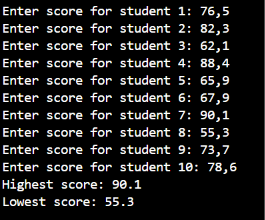
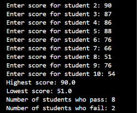
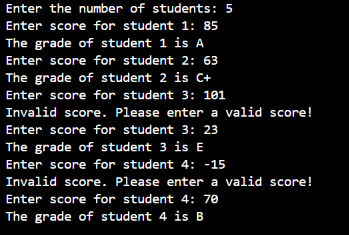
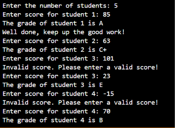

# REPORT JOBSHEET 7: LOOPS 1

Name: Davina Tegar Putri Ervia

Student ID: 264107020083

GitHub: https://github.com/davinategar

# 1. Learning Objective

* Students are able to explain the syntax for writing loop programs (for, while, and do-while).

* Students are able to implement loop flowcharts using the Java programminglanguage.

# 2. Practical Exercise 

## 2.1 Experiment 1: Student Grades Case Study in SIAKAD – FOR Loop

### 2.1.1 Experimental Steps 

```
import java.util.Scanner;

public class SiakadForAttendance07 {
    public static void main(String[] args) {
        Scanner sc = new Scanner(System.in);

        double score, highest = 0, lowest = 100;

        for (int i = 1; i <= 10; i++) {
            System.out.print("Enter score for student " + i + ": ");
            score = sc.nextDouble();
            if (score > highest) {
                highest = score;
            }
            if (score < lowest) {
                lowest = score;
            }
        }

        System.out.println("Highest score: " + highest);
        System.out.println("Lowest score: " + lowest);
    }
}
```

### 2.1.2 Verification of Experimental Results



### 2.1.3 Questions

1. Identify and indicate each component of the FOR loop in the program code of Experiment1!

Answer: 

* Initialization: ```int i = 1``` – starts the loop from student 1.
* Condition: ```i <= 10``` – the loop continues while i is less than or equal to 10.
* Update: ```i++``` – increases the value of ```i``` by ```1``` after each loop.

2. Why is the variable highest initialized to 0 and the variable lowest initialized to 100? Whathappens if highest is initialized to 100 and lowest is initialized to 0?

Answer: 

* ```highest = 0``` is used because 0 is the lowest possible starting score. This allows the program to find a higher score.
* ```lowest = 100``` is used because 100 is the highest possible score. This allows the program to find a lower score.

If ```highest``` is initialized to 100 and ```lowest``` is initialized to 0, the program may produce incorrect results because no score can be higher than 100 or lower than 0.

3. Explain the function and workflow of the following code snippet!

Answer:

```
if (score > highest) {
    highest = score;
}

if (score < lowest) {
    lowest = score;
}
```

Eksplanation:
* ```if (score > highest)``` checks whether the current score is higher than the highest score.
* ```highest = score``` updates the highest score if the condition is true.
* ```if (score < lowest)``` checks whether the current score is lower than the lowest score.
* ```lowest = score``` updates the lowest score if the condition is true.

The code compares each student's score and keeps updating the highest and lowest scores.

4. Modify the program to count how many students pass and how many students fail, based on the passing threshold (minimum score of 60).

Answer:

```

import java.util.Scanner;

public class SiakadForAttendance07 {
    public static void main(String[] args) {
        Scanner sc = new Scanner(System.in);

        double score, highest = 0, lowest = 100;
        int pass = 0, fail = 0;

        for (int i = 1; i <= 10; i++) {
            System.out.print("Enter score for student " + i + ": ");
            score = sc.nextDouble();

            if (score > highest) {
                highest = score;
            }

            if (score < lowest) {
                lowest = score;
            }

            if (score >= 60) {
                pass++;
            } else {
                fail++;
            }
        }

        System.out.println("Highest score: " + highest);
        System.out.println("Lowest score: " + lowest);
        System.out.println("Number of students who pass: " + pass);
        System.out.println("Number of students who fail: " + fail);
    }
}
```

Result: 



Passing rule:
* Score 60 or above = Pass.
* Score below 60 = Fail.

## 2.2 Experiment 2: Student Grades Case Study in SIAKAD – WHILE Loop

### 2.2.1 Experimental Steps

```

import java.util.Scanner;

public class SiakadWhileAttendance07 {
    public static void main(String[] args) {
        Scanner sc = new Scanner(System.in);

        int studentCount, score, i = 0;

        System.out.print("Enter the number of students: ");
        studentCount = sc.nextInt();

        while (i < studentCount) {
            System.out.print("Enter score for student " + (i + 1) + ": ");
            score = sc.nextInt();

            if (score < 0 || score > 100) {
                System.out.println("Invalid score. Please enter a valid score!");
                continue;
            }

            if (score > 80) {
                System.out.println("The grade of student " + (i + 1) + " is A");
            } else if (score > 73) {
                System.out.println("The grade of student " + (i + 1) + " is B+");
            } else if (score > 65) {
                System.out.println("The grade of student " + (i + 1) + " is B");
            } else if (score > 60) {
                System.out.println("The grade of student " + (i + 1) + " is C+");
            } else if (score > 50) {
                System.out.println("The grade of student " + (i + 1) + " is C");
            } else if (score > 39) {
                System.out.println("The grade of student " + (i + 1) + " is D");
            } else {
                System.out.println("The grade of student " + (i + 1) + " is E");
            }

            i++;
        }
    }
}
```

### 2.2.2 Verification of Experimental Results



### 2.2.3 Questions

1. In the following code snippet, determine the meaning and purpose of the following syntax

   ```
   if (score < 0 || score > 100) {
                System.out.println("Invalid score. Please enter a valid score!");
                continue;
            }
   ```

Answer:

* ```score < 0 || score > 100``` This condition checks whether the score is less than 0 or greater than 100.
* The ```continue``` statement skips the remaining code in the current loop and returns to the beginning of the                WHILE loop. It allows the student to enter their score again without increasing the value of ```i```.

2. Why is the i++ statement written at the end of the WHILE loop? What happens if it iswritten at the beginning of the WHILE loop?

Answer:

The ```i++``` statement is written at the end of the WHILE loop to increase the student counter after a valid score has been entered and processed. If ```i++``` is written at the beginning, the counter will increase before the score is entered. This can cause the program to skip the first student or count incorrectly, especially when an invalid score is entered.

3. If the number of students entered is 19, how many times will the WHILE loop run?

Answer:

The WHILE loop will run 19 times if all students enter valid scores. This is because the condition ```i < studentCount starts with``` ```i = 0``` and continues until ```i = 18.``` If a student enters an invalid score, the loop repeats for that student until a valid score is entered.

4. Modify the program so that, if a student receives grade A, the program displays an additional message.

Answer:

The code:

```

import java.util.Scanner;

public class SiakadWhileAttendance07 {
    public static void main(String[] args) {
        Scanner sc = new Scanner(System.in);

        int studentCount, score, i = 0;

        System.out.print("Enter the number of students: ");
        studentCount = sc.nextInt();

        while (i < studentCount) {
            System.out.print("Enter score for student " + (i + 1) + ": ");
            score = sc.nextInt();

            if (score < 0 || score > 100) {
                System.out.println("Invalid score. Please enter a valid score!");
                continue;
            }

            if (score > 80) {
                System.out.println("The grade of student " + (i + 1) + " is A");
                System.out.println("Well done, keep up the good work!");
            } else if (score > 73) {
                System.out.println("The grade of student " + (i + 1) + " is B+");
            } else if (score > 65) {
                System.out.println("The grade of student " + (i + 1) + " is B");
            } else if (score > 60) {
                System.out.println("The grade of student " + (i + 1) + " is C+");
            } else if (score > 50) {
                System.out.println("The grade of student " + (i + 1) + " is C");
            } else if (score > 39) {
                System.out.println("The grade of student " + (i + 1) + " is D");
            } else {
                System.out.println("The grade of student " + (i + 1) + " is E");
            }

            i++;
        }
    }
}
```

Result: 



## 2.3 Experiment 3: Café Transaction Case Study – DO-WHILE Loop

### 2.3.1 Experimental Steps

